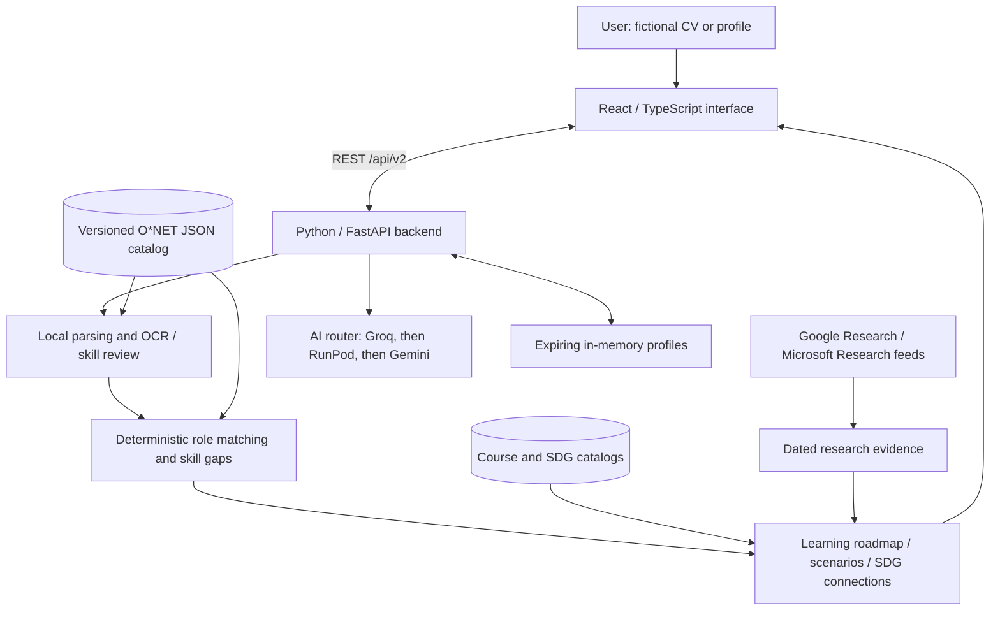

# Ikiguy

An evidence-aware career navigator for SDC Hackathon 2026, Domain 1: **The Aiversecity Future-Ready Workforce**.

Ikiguy helps students, graduates and early-career professionals connect their skills to suitable occupations and practical learning goals. Upload a fictional CV, review its extracted skills, explore explainable career matches, and compare learning priorities across hypothetical AI-change scenarios.

[Source code](https://github.com/ProProcer/here-we-go-sdc) · [Documentation](docs/README.md) · [Replit instructions](replit.md)

## Project overview

| Item | Details |
|---|---|
| App name | Ikiguy |
| Team name | Here We Go |
| Hackathon | SDC Hackathon 2026 |
| Domain | Domain 1: The Aiversecity Future-Ready Workforce |
| How to run the project | Follow [Run locally](#run-locally) for installation and startup commands, then open http://localhost:8000. |
| Live demo | [Try Ikiguy](https://here-we-go-sdc.replit.app) |
| Pitching video | [Pitching Video](https://youtu.be/XASOrQQj72U) |

## Project links

| Resource | Link |
|---|---|
| GitHub repository | [ProProcer/here-we-go-sdc](https://github.com/ProProcer/here-we-go-sdc) |
| Replit project | [Replit Project](https://replit.com/@Proprocer/here-we-go-sdc) |
| Live demo | [Ikiguy](https://here-we-go-sdc.replit.app) |
| RunPod endpoint | https://api.runpod.ai/v2/mw04eleb91hr3t |
| Slide deck | [View Ikiguy Pitch Presentation](docs/presentation/Ikiguy-Pitch/Ikiguy-Pitch.pdf) |
| Pitching video | [Pitching Video](https://youtu.be/XASOrQQj72U) |

## Features and status

- Parse PDF, DOCX, TXT, JPG and PNG CVs, including scanned documents through local CPU OCR.
- Normalize skills against O*NET and optionally estimate proficiency using AI. Users review evidence and confirm or correct their profile.
- Rank occupations using explainable skill alignment, job-relative proficiency suitability and visible skill gaps.
- Display dated research evidence and conditional interpretations of how AI could affect occupational tasks.
- Compare Baseline, Moderate and Rapid scenarios without changing personal fit scores.
- Build learning roadmaps with verified resources where available, practice objectives, prerequisite guidance and explained SDG connections.

Try the hosted application at [here-we-go-sdc.replit.app](https://here-we-go-sdc.replit.app). See the [dated verification report](docs/FINAL_VERIFICATION.md) and [provider verification notes](docs/AI_PROVIDERS.md) for recorded local checks. Research and verified course coverage remain limited.

## Architecture



Replit runs one FastAPI server serving the built frontend and API. RunPod hosts the separate GPU inference endpoint. GitHub Actions supports scheduled research discovery and review artifacts. No separate database server is required.

| Layer | Technologies |
|---|---|
| Frontend | React, TypeScript, Vite, Tailwind CSS |
| Backend | Python, FastAPI, Pydantic, Uvicorn |
| Documents and OCR | pypdf, python-docx, pypdfium2, Pillow, RapidOCR, ONNX Runtime |
| AI | Groq GPT-OSS-120B; RunPod GLM-4.7-Flash; Google Gemini fallback |
| Storage | Versioned JSON catalogs; temporary in-memory profiles; local runtime caches |
| Deployment and automation | Replit; RunPod Serverless; GitHub Actions |

Python dependencies are pinned in [requirements.txt](requirements.txt) and [requirements-dev.txt](requirements-dev.txt). Frontend dependencies are locked in [frontend/package-lock.json](frontend/package-lock.json).

## Run locally

Requirements: **Python 3.12** and **Node.js 22.12 or newer**, with npm.

From the repository root on Linux or macOS:

```bash
python -m venv .venv
source .venv/bin/activate
python -m pip install -r requirements.txt
npm --prefix frontend ci
npm --prefix frontend run build
python -m src.main
```

On Windows, activate the environment with `.venv\Scripts\Activate.ps1` in PowerShell before running the remaining commands.

Open **http://localhost:8000**, select **Try sample**, review and confirm the fictional profile, and explore careers. The server reads `PORT`; the local default is `8000`. `GET /health` returns `{"status":"ok"}`.

For frontend development, keep Python running and start Vite in a second terminal:

```bash
npm --prefix frontend run dev
```

Open **http://localhost:5173**. Vite forwards `/api` to the backend on port 8000. Rebuild the frontend to see changes through the Python-served application.

## Configure AI services

Local parsing, profile review, deterministic matching and cached learning resources work without API credentials. AI assessments, generated interpretations, dependency maps and translations require an available configured provider.

Copy [.env.example](.env.example) to `.env` locally, or add settings to **Replit Secrets**:

| Setting | Purpose |
|---|---|
| `LLM_PROVIDER=groq` | Primary provider |
| `LLM_FALLBACK_PROVIDER=runpod,gemini` | Fallback order |
| `GROQ_API` | Groq credential; `GROQ_API_KEY` is also accepted |
| `GROQ_MODEL=openai/gpt-oss-120b` | Primary model |
| `RUNPOD_API_KEY`, `RUNPOD_ENDPOINT_ID` | Existing RunPod endpoint credentials and identifier |
| `RUNPOD_MODEL=zai-org/GLM-4.7-Flash` | RunPod model |
| `GEMINI_API_KEY`, `GEMINI_MODEL` | Final backup; configured default is `gemini-3.1-flash-lite` |
| `TREND_AUTO_REFRESH=1` | Refresh public research feeds every 24 hours while running |

Only availability failures trigger fallback. Invalid schemas or unsupported evidence fail validation. Responses record the actual provider and model. Keep credentials out of Git, frontend code and documentation. See [AI provider setup](docs/AI_PROVIDERS.md) for timeouts, RunPod configuration and inference provenance.

## Deploy on Replit

1. Import this repository through [Replit Import](https://replit.com/import), including `.replit`, `replit.nix`, `requirements.txt`, `src/`, `frontend/` and `data/`. Exclude `.env`, dependency folders and local caches.
2. Install Python dependencies from `requirements.txt` in Replit's managed Python environment. Click **Run** to install frontend dependencies, build the UI and start FastAPI. Check the preview and `/health`.
3. Add provider settings through Secrets and verify they are available to the published application.
4. Open **Publishing**, choose **Reserved VM**, and retain the build/run commands from [.replit](.replit). Use one server because profiles are stored in process memory.
5. Publish, open the public URL and repeat the sample CV journey. Save the verified URL and genuine platform-use evidence for submission.

| Setting | Repository configuration |
|---|---|
| Runtime | Python 3.12 and Node.js 22 |
| Start command | `env -u LD_LIBRARY_PATH python -m src.main` |
| Bind address | `0.0.0.0` |
| Internal / external port | `5000` / `80` |
| Port environment variable | `PORT=5000` |

Preserve the `env -u LD_LIBRARY_PATH` wrappers: inherited native-library settings previously broke the managed Node runtime. Replit uses managed Python dependencies; the virtual-environment instructions above are for local development. If the publishing dialog reports a deployment-target change, close it, let `.replit` save, and reopen it. See [replit.md](replit.md) for environment-specific guidance.

## Verification

Install development dependencies, build the frontend, then run the backend suite:

```bash
python -m pip install -r requirements-dev.txt
npm --prefix frontend ci
npm --prefix frontend run build
python -m unittest discover -s tests -v
```

Browser checks are opt-in:

```bash
python -m playwright install chromium
RUN_BROWSER_TESTS=1 python -m unittest discover -s tests -p test_browser.py -v
```

Browser tests start their own server. Set `BROWSER_CHANNEL=msedge` for installed Microsoft Edge or `BROWSER_ARTIFACT_DIR` to save screenshots outside the source tree. Recorded evaluations and fictional fixtures are linked from the [documentation index](docs/README.md). Historical results do not establish that every fresh environment has passed those checks.

## Data, privacy and limitations

- Use fictional CVs for demonstrations. Uploads and profiles are processed in memory rather than intentionally written to disk. Profiles expire after one hour and disappear on restart; expiry is enforced on access and stale entries are removed during session creation.
- AI assessment sends selected skill evidence snippets to configured providers. Snippets may contain personal information from a real CV; automatic anonymization is not guaranteed. Provider retention follows applicable service terms.
- O*NET describes U.S. occupations. It does not establish Malaysian hiring demand, professional eligibility or employment probability.
- AI estimates and OCR can be wrong. Users review skills before matching; hypothetical scenarios are illustrations rather than forecasts.
- Research and verified course coverage are limited. Missing evidence and resources are shown explicitly. Generated interpretations do not constitute human approval.
- The prototype has no user-account system or persistent profile database. One server process is required for the current session design.

## Repository guide

```text
frontend/          React application and build configuration
src/               Backend, ingestion, matching, AI and learning modules
data/              Source catalogs, processed data, review records and synthetic fixtures
tests/             Backend and opt-in browser tests
scripts/           Maintenance, evaluation and provider setup tools
runpod/            GPU configuration and optional worker tools
docs/              Technical documentation and dated verification evidence
docs/archive/      Original planning materials retained for provenance
submission/        Official form and platform-use documents
.github/workflows/ Scheduled evidence discovery
```

## License and attribution

Original project code is licensed under [Apache 2.0](LICENSE). Third-party software, datasets, model weights and research excerpts retain their own licenses and terms.

O*NET® data are adapted from the U.S. Department of Labor/Employment and Training Administration database under **CC BY 4.0**. O*NET® is a USDOL/ETA trademark; USDOL/ETA has not approved, endorsed or tested these adaptations. See [data sources and modifications](docs/DATA_SOURCES.md).

Linked course materials and research excerpts remain subject to publisher terms. Public availability does not relicense source content under this project's license. Pre-trained model licenses and API terms also apply; see [provider documentation](docs/AI_PROVIDERS.md).

Generative AI assisted with implementation, debugging, test development and documentation. Application output is constrained and validated, and the team remains responsible for reviewing code, claims and submission materials. Historical planning documents and template PDFs preserve provenance; they do not establish that deployment or submission is complete.
