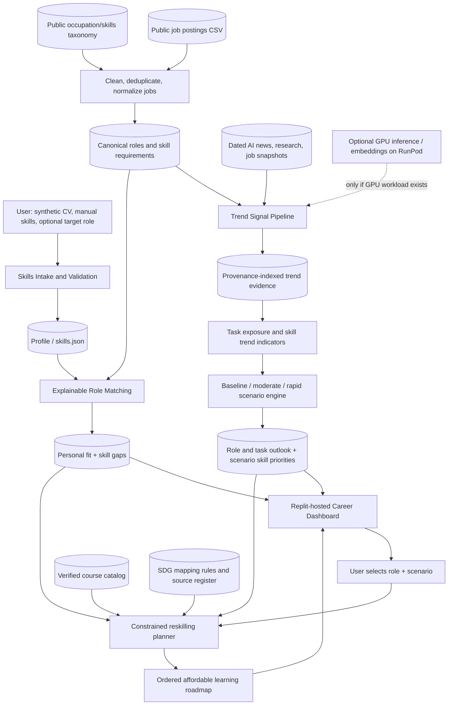

# FutureReady AI — Comprehensive Project Specification

> **Document status:** Team planning / technical specification, **not** an official submitted application.  
> **Competition:** SDC Hackathon 2026 — Domain 1: The Aiversecity Future-Ready Workforce Domain  
> **Version:** 1.0 (20 October 2026)  
> **Primary audience:** Registered team members, technical contributors, judges reading the README, and collaborators onboarding to the codebase.  
> **Decision owner:** The registered team; all placeholders and proposed metrics require team review.  
> **Submission form:** See `docs/PRELIMINARY_PROPOSAL_DRAFT.md`; transfer confirmed answers to the actual PDF form in `submission/`.

---

## Table of contents

1. [Authoritative sources and conflict resolution](#1-authoritative-sources-and-conflict-resolution)
2. [Executive summary](#2-executive-summary)
3. [Problem, users and constraints](#3-problem-users-and-constraints)
4. [Solution, value proposition and user journey](#4-solution-value-proposition-and-user-journey)
5. [Requirements and acceptance criteria](#5-requirements-and-acceptance-criteria)
6. [System architecture](#6-system-architecture)
7. [Detailed processing pipelines](#7-detailed-processing-pipelines)
8. [Canonical datasets and contracts](#8-canonical-datasets-and-contracts)
9. [Matching, trend and scenario methodology](#9-matching-trend-and-scenario-methodology)
10. [Personalized reskilling and SDG engine](#10-personalized-reskilling-and-sdg-engine)
11. [Interface specification](#11-interface-specification)
12. [Technology stack and deployment](#12-technology-stack-and-deployment)
13. [Repository structure](#13-repository-structure)
14. [Five-person division of labor](#14-five-person-division-of-labor)
15. [Milestones, sequencing and integration](#15-milestones-sequencing-and-integration)
16. [Testing, evaluation and impact measurement](#16-testing-evaluation-and-impact-measurement)
17. [Risk register and contingency plan](#17-risk-register-and-contingency-plan)
18. [Rules, integrity and submission checklist](#18-rules-integrity-and-submission-checklist)
19. [Decisions, assumptions and open questions](#19-decisions-assumptions-and-open-questions)
20. [Source register](#20-source-register)

---

## 1. Authoritative sources and conflict resolution

The team must use the supplied official material, not an inferred interpretation of an online template, as the source of competition rules. This is a planning interpretation, not a replacement for organizer instructions.

### 1.1 Document hierarchy

1. **Official Terms & Conditions** — highest priority for legal/policy rules: originality, eligibility, repository timing, conduct, submission validity, freezes, intellectual property, permitted assistance and official amendments.
2. **Official Participant Handbook** — detailed *operational* instructions: round dates and times, submission items, Replit/RunPod rules, public repository accessibility, finalist instructions, proof of use. It governs operational specifics except when it conflicts with the Terms & Conditions.
3. **Official Handbook** — earlier high-level overview. Its own conflict clause gives the Participant Handbook precedence on operations, but preserves Terms & Conditions for policy.
4. **Domain 1 sponsor brief** — domain-specific problem statement, mandatory product capabilities, permissible demonstration data, judging criteria and constraints. Apply alongside the official rules; do not treat it as permission to breach them.
5. **GitHub starter ZIP and preliminary proposal form** — implementation/submission *templates*, not overrides of the official rules. Use the actual proposal form and its word limits when submitting.
6. **This specification** — team design proposal, subordinate to every official document and official changes communicated during the competition.

**Latest published official announcements win where the organizer has legitimately amended a requirement.** The Terms & Conditions expressly permit updates through official communication channels. Preserve screenshots/messages of an amendment and update this plan accordingly.

### 1.2 Concrete conflicts, apparent conflicts and resolutions

| Topic | Documents / apparent mismatch | Team action | Authority |
|---|---|---|---|
| GitHub creation | Participant Handbook §6.1.2 suggests preparing the repository before the event; Terms & Conditions §5.5.2 says create it *only after* official commencement. | **Never reuse the starter ZIP's embedded `.git` history. Create a fresh competition repository only after the 19 Oct 2026, 8:00 PM MYT problem reveal.** Keep authentic incremental commits. | Terms & Conditions §§5.3, 5.5 |
| Private vs public repository | Participant Handbook §6.1 advises private *during* development; §10.3 requires public *for judging*. | Develop privately if desired, add designated organizer collaborators, then switch to **public before preliminary submission**, and keep accessible throughout judging. | Participant Handbook §§6.1, 10 |
| Existing starter code | Official Handbook §8.2 discusses prior declaration/approval; Terms & Conditions §§5.4, 5.8 allow reasonable utilities/frameworks as support but not a prebuilt core. | Start an original implementation, list the supplied starter/third-party materials, disclose any pre-existing code; seek written organizer approval if in doubt. Do not submit a recycled project. | Terms & Conditions §§5.1–5.8 |
| RunPod template wording | ZIP README labels RunPod “Required”; Participant Handbook §9.4 requires RunPod for **work needing a GPU** and §10.7 asks proof **if used**. | **Replit is mandatory; RunPod is conditional on GPU-dependent work.** If using GPU-dependent inference/training, do it on RunPod and provide real proof. Do not claim RunPod use merely because placeholder files exist. | Participant Handbook §§9–10 |
| Modification after submission | Terms & Conditions §6.6 and Participant Handbook §6.3 prohibit changes after preliminary deadline; Participant Handbook §6.5 explicitly authorizes finalists to upgrade in Phase 2. | Freeze the **preliminary submitted version during judging**; resume or branch only upon finalist authorization/Phase 2 instructions, preserving preliminary tag and audit trail. Clarify with organizer if instructions conflict. | Terms & Conditions §6.6 and authorized phase instructions |
| Final pitch schedule | Participant Handbook §6.7.1 lists 1 Nov **18:00–20:30 MYT** but its §7.2 rundown lists pitches **09:40–15:40**; venues also differ between its venue table and §6.7.3. | **Unresolved internal operational inconsistency.** Seek explicit organizer confirmation on Discord before making transport/presentation plans; do not treat either slot as confirmed. | Official organizer clarification required |
| Domain restriction vs broader data advice | General handbook permits public datasets; Domain 1 explicitly says public, open or **synthetic**, with no real personal data/real CVs for demo. | Use only synthetic CVs and suitable licensed public/open job, research and course metadata; no real candidate CV in judged demo. | Domain 1 rules, alongside privacy rules |

### 1.3 Known competition dates (MYT, UTC+8)

| Stage | Officially stated time / deadline | Required team action |
|---|---|---|
| Competition starts / challenge announced | 19 Oct 2026, 20:00 | Build project **after** this point; repository creation must not predate commencement. |
| Preliminary development | 19 Oct 20:00 — **25 Oct 07:59:59** | Build prototype, complete proposal and other six deliverables. |
| Preliminary submission | **25 Oct 2026, 07:59:59** | Submit through `sdchack.my`; public repo, accessible app, working links, declarations and video. |
| Judging / shortlisting | 25–28 Oct 2026 | Freeze submitted version, await updates. |
| Finalist announcements | 28 Oct 2026, 20:00 | If selected, submit confirmation before **29 Oct 12:00**. |
| Online upgrading | 28–30 Oct 2026 | Finalists may improve solution pursuant to phase rules and official authorization. |
| Physical final | 31 Oct 2026 | Prepare working laptop, adapters, credentials and offline backups. |
| Final submission | **1 Nov 2026, 07:59:59** | Final-stage deliverables submitted on time. |
| Final pitching | 1 Nov 2026 | Exact time/venue **must be reconfirmed** because participant handbook sections conflict. |

**Time-sensitive note:** Dates are from the supplied PDF versions as of drafting. Official Discord/portal amendments may supersede these.

---

## 2. Executive summary

**Project working name:** **FutureReady AI** (rename only after team agreement).

**One-sentence pitch:** FutureReady AI turns a synthetic candidate's skills into explainable career matches, evaluates how evidence-based AI developments may reshape each role, and produces verifiable, affordable learning pathways that adapt across hypothetical disruption scenarios and explain their contributions to the UN SDGs.

**Why this differs from “upload a CV and ask a chatbot for jobs”:** the **same user profile** can generate *different, traceable learning priorities* when dated job-market observations or explicit AI-disruption assumptions change. The system separates personal **readiness** from labor-market **outlook**, grounds all factual statements in data provenance, and never passes simulated news off as real evidence.

**Primary beneficiaries:** Malaysian fresh graduates and early-career workers considering entry-level data, business, technology and adjacent roles. This is an intentionally narrow **MVP focus**, not a statement that the domain excludes other audiences.

**Primary outcome:** Within minutes, a person can inspect suitable roles, understand their specific skill gaps and limitations of forecasts, select a role, and receive an ordered plan with real course links, estimated time/cost, and meaningful SDG mapping.

**SDGs:** Core **SDG 4** (especially Target 4.4 relevant technical/vocational skills) and **SDG 8** (Targets 8.2 and 8.5); optional role-specific **SDG 9**, **SDG 10** and others where a clear causal link can be explained. Do not tag every role with unrelated SDGs merely to inflate coverage.

---

## 3. Problem, users and constraints

### 3.1 Problem

AI capabilities change task composition and skill requirements faster than static career guidance and course catalogs can adapt. Prospective workers struggle to answer: *What can I do with my current capabilities? Which related roles might be worth preparing for? Which skills actually separate me from those roles? What evidence supports any claim about how AI will affect them? What is the cheapest credible route to closing the gaps?*

The sponsor brief cites uneven workplace AI uptake versus formal training and emphasizes that single-point assessments become stale. These contextual claims should be separately verified against the original sources before being restated as validated statistics in the final pitch.

### 3.2 Personas and jobs-to-be-done

- **Primary persona A — graduate:** has coursework and projects, wants realistic adjacent careers and an inexpensive short learning plan.
- **Primary persona B — early-career switcher:** has transferable skills and needs a gap analysis without being incorrectly treated as a complete beginner.
- **Secondary future persona — HR/learning manager:** views aggregated skills and training plans; **out of scope for the preliminary MVP**.

### 3.3 Scope

**In scope:** synthetic CV/profile ingestion, skill normalization, a bounded public job dataset, standardized occupations, explainable matches, dated AI/job-market source ingestion, task-level impact assessment, baseline plus moderate/rapid scenarios, verifiable course retrieval, cost/time/prerequisite-aware pathway, role+skill SDG explanation, interactive Replit-hosted dashboard, evaluation and traceability.

**Out of scope:** hiring decisions, guarantees of employment/salary/demand, real job applications, private recruitment integrations, course payments, creating full courses, personal data storage, claiming quantitative job loss forecasts without data, a fully comprehensive real-time catalog of all vacancies, large-scale scraping, company-level HR administration.

**Fairness design:** do not use age, gender, nationality, ethnicity or other protected attributes as rank features; support user review and correction of extracted skills; clearly explain recommendations; avoid sorting by opaque “employability”.

---

## 4. Solution, value proposition and user journey

### 4.1 Standard journey

1. Open an accessible demo link and choose one of several **synthetic** CVs (optional upload of fictional CV) or fill in a profile form.
2. Optionally enter a desired role. This role is **pinned** to the result table even when its match score is not high; preference must not silently inflate suitability.
3. Review extracted skills and supporting passages. Edit mistakes before continuing.
4. View ranked standardized roles, their sector, **fit score**, top matching evidence, missing high-priority skills and **separate** role outlook.
5. Click a role to open **Skills Gap**, **AI Outlook**, and **Reskilling Roadmap** tabs.
6. Inspect real news/job/research evidence with source and date. Distinguish measured observation, modeled inference and unknowns.
7. Change between **Baseline (observed evidence)**, **Moderate disruption (synthetic)** and **Rapid disruption (synthetic)**.
8. Observe role/task exposure and learning priorities change under the scenario; do **not** present hypothetical percentages as measured predictions.
9. Generate a step-by-step personalized course pathway with prerequisites, effort, cost, source URL and SDG target rationale.
10. Optionally save a **local demo plan** without transmitting real personal data.

### 4.2 What the judge should see

One continuous demo: fictional resume → editable skills → ranked roles and actual skill gaps → cited AI evidence → injected labeled shock → visible change in *outlook and pathway* → affordable courses → justified SDGs. **The changed output must be computed from data/parameters, not a manually swapped screenshot.**

---

## 5. Requirements and acceptance criteria

The sponsor describes **six mandatory features**. All six must have demonstrable coverage and a clear implementation explanation for Phase 1.

| ID | Mandatory feature | Implemented capability | Preliminary acceptance test |
|---|---|---|---|
| FR-1 | Skills profile intake | Parse synthetic CV/PDF or accept typed skills/interests; produce validated `SkillsProfile` with editable extracted evidence | A test CV produces expected normalized skills; manual correction affects matching |
| FR-2 | AI-trend signal layer | Refreshable job-market observations and/or dated news/research; recorded source URL, date and type | Add/update one dated signal; show corresponding UI provenance and a changed affected derived indicator |
| FR-3 | Future-role matching | Ranked standardized roles with repeatable fit score **and missing-skill breakdown** | Given deterministic sample profile, API returns stable score components and required gaps |
| FR-4 | Personalized reskilling pathway | Ordered prerequisite-aware learning actions with genuine low/free-cost resource URLs, price currency and estimated hours | Target role returns ordered plan; invalid or unverified courses are excluded or clearly marked |
| FR-5 | SDG mapping | Explicit role+skill → SDG target connection and why it matters | Every recommended role/skill has at least one defensible SDG mapping with explanatory text |
| FR-6 | Handling uncertainty | Baseline alongside moderate and rapid synthetic scenarios, labeled assumptions and non-deterministic conclusions | Switching scenario changes relevant importance/outlook and pathway; confidence caveat visible |

Nonfunctional requirements:

- **NFR-1 Provenance:** evidence-backed claims include source, publication/observation date, retrieval date and derivation stage; no invented jobs, courses or statistics.
- **NFR-2 Reproducibility:** snapshots, versioned configurations and seeded fixtures reproduce demo outputs.
- **NFR-3 Reliability:** when feed or LLM unavailable, show cached/verified results and stale-data warning instead of fabricating information.
- **NFR-4 Performance:** optimize for a responsive demo; define and measure a time-to-roadmap KPI before claiming success.
- **NFR-5 Privacy:** only synthetic demo CVs; never log raw CV content, API secrets or generated personal records.
- **NFR-6 Explainability:** separate fit, outlook, risk, assumptions and scenarios; show skill-by-skill reasons.
- **NFR-7 Compliance:** Replit usage documented; RunPod GPU workloads routed there if present; public Apache-2.0 repository at submission, lawful source use, clear commit history.

---

## 6. System architecture

### 6.1 Logical architecture



### 6.2 Two independent clock domains

- **Offline/batch evidence domain:** refresh postings, role aggregates, course validity and trend sources periodically. Store source times and versions. This does **not** run on every page click.
- **On-demand personalization domain:** read the current validated user profile and current evidence snapshot, compute candidate role scores, chosen scenario effects and a customized learning plan. Cached role/trend summaries keep latency manageable.

**Key design correction:** the trend pipeline is **not merely an LLM explanation after clicking a role**. Its structured output flows into role-outlook presentation and changes the prioritized skills used by the planner.

### 6.3 High-level deployment

```text
Browser
   |
   v
Replit (required; deployed web app)
  - FastAPI + Jinja2/HTMX frontend
  - Pydantic validation and modular Python services
  - SQLite + checked-in small demo fixtures
  - HTTP endpoints for role data, scenarios and pathways
  - Secrets in environment, not repository
   |              |                  |
   |              +-- public, licensed source feeds / external LLM API (optional)
   +-- local CPU embeddings / deterministic matching
   +-- RunPod endpoint, ONLY if team actually uses GPU-based models
```

This is **one deployable application**, not five separately deployed microservices. Modules have Python/Pydantic contracts so five people can build them independently. The starter `.replit` command and `src/main.py` must be updated from their placeholder echo/demo logic.

---

## 7. Detailed processing pipelines

### 7.1 Pipeline A — Profile intake

**Inputs:** fictional PDF CV or short structured form; optional `desired_role_id`; optional interests/budget/time per week.

**Steps:** extract text → locate claims → map synonyms to skill taxonomy → estimate limited evidence strength → produce structured output → allow manual review → validate via Pydantic → store ephemeral `skills.json` fixture or in-memory session.

**Outputs:** standardized skills and experience items, human-confirmed proficiency (when supplied), unconfirmed proficiency otherwise, evidence span/source, profile constraints.

**Safeguards:** avoid treating mere mention as mastery; avoid false `0.91 confidence` unless extraction confidence has been calibrated; deduplicate aliases (e.g. PostgreSQL vs SQL skill hierarchy); clearly mark unknown skills rather than missing; do not store real CVs during demo.

### 7.2 Pipeline B — Job-posting ingestion and canonical roles

**Inputs:** permitted public/open postings CSV and optional ESCO/O*NET-type taxonomy metadata (validate license/terms before inclusion).

**Steps:** ingest → validate required columns → deduplicate employer/title/URL → label observed date and region → normalize job titles to canonical `role_id` → map sector → extract required skills to taxonomy IDs → compute evidence counts/support → review obvious errors → persist role snapshots.

**Outputs:** `job_postings`, `roles`, `role_required_skills` and role-to-sector relation. The user-specific `match_score` belongs in a **response/result table**, not the canonical role table.

**Limitations:** a current cross-sectional CSV describes vacancies, **not a trend**. To claim an increase/decrease, use comparable historical snapshots or cited longitudinal reports, with coverage and sample-size caveats. Do not claim “all current jobs”; use a curated representative set for initial prototype.

### 7.3 Pipeline C — Baseline trend intelligence

**Inputs:** timestamps of observed postings, curated news/research text, trusted-source URLs, affected occupations/tasks and domain-specific mapping rules.

**Steps:** fetch permitted feed/snapshot → save raw metadata → classify claims into `AI_CAPABILITY`, `TASK_AUTOMATION`, `TASK_AUGMENTATION`, `SKILL_DEMAND`, `JOB_MARKET` → extract affected tasks/skills and qualifiers → human-review sensitive claims → store evidence → derive a **bounded**, explainable qualitative outlook and changing priorities.

**Outputs:** `TrendSignal[]`, role-skill impact descriptors, evidence count and coverage flags, observed snapshot date; baseline outlook may be `insufficient_data`.

**Important distinction:** *a new AI capability* is not direct evidence of *job losses*. Task automation exposure, employer adoption, regulations, labor demand, and complementarity may diverge. Prefer `rising signal`, `mixed`, `declining signal`, `insufficient evidence` over false precision.

### 7.4 Pipeline D — Role matching

**Inputs:** `SkillsProfile`, `RoleCatalog`, required-skill importance, role constraints and the optional manually chosen role.

**Steps:** merge skill synonyms → calculate weighted required-skill coverage → recognize transferable competencies → optional stated preference fit → calculate deterministic 0–100 **personal fit** → produce matched and missing skills with contribution weights → sort by score → pin manually chosen role as a user-control indicator.

**Outputs:** `RoleMatch[]`: `role_id`, `sector`, `fit_score`, `score_breakdown`, `matched_skills`, `missing_skills`, `warnings`; attach **separate** `RoleOutlook` for the UI.

**Do not:** directly add an AI forecast score to the candidate fit, make hiring/employability claims, or silently change a score simply because the user typed that job title.

### 7.5 Pipeline E — Scenario stress testing

**Inputs:** baseline model outputs and **typed synthetic scenario records**, *not counterfeit articles*. Example scenarios are `moderate_ai_change` and `rapid_ai_change`, scoped to task families and specified assumptions.

**Steps:** validate `synthetic=true` → apply assumptions to affected tasks and skill priority weights → recompute scenario outlook indicators → recompute learning-plan priorities (not fabricate course records) → compare deltas to baseline → render explanation and visible synthetic badge.

**Outputs:** `ScenarioResult`: affected task IDs, adjusted priorities, scenario assumptions, rationale, baseline comparison; this is an **illustrative stress test**, not a job-market forecast.

### 7.6 Pipeline F — Agentic reskilling and SDG mapping

**Inputs:** confirmed profile, chosen role, missing-skill gap list, preferred time/budget, scenario priority weights, verified course catalog, SDG rules.

**Steps:** prioritize missing skills → resolve prerequisites → retrieve resources → validate provider/link/coverage/availability/fees/duration → optimize course sequence for coverage/price/time → return milestones → attach role+skill SDG target rationales → cite each course/source. Optional research agent retrieves *candidates*, never auto-approves unverified course claims.

**Outputs:** `LearningPlan`: ordered steps, exact learning goals, validated source URLs, hours, cost/currency/verification timestamp, skill coverage, total estimates where all inputs known, SDG explanations and warnings.

**Fail safely:** if no valid course is found, return “verified resource not found” plus a self-study skill objective; do **not** invent a provider or price.

---

## 8. Canonical datasets and contracts

### 8.1 Repository data ownership

| Entity / file | Owner | Minimum required fields | Primary purpose |
|---|---|---|---|
| `data/raw/jobs_sample.csv` | Person 1 | posting_id, title, description, employer, location, source_url, observed_at | Raw permitted listings (or synthetic flagged fixture) |
| `data/processed/roles.json` | Person 1 | role_id, role_title, sector_id, source_ids, updated_at | Canonical role catalog |
| `data/processed/role_skills.json` | Person 1 | role_id, skill_id, importance, evidence_ids | Requirements used for matching |
| `data/synthetic/profiles/*.json` | Person 2 | profile_id, skills, interests, desired_role_id | Synthetic demo profiles |
| `data/processed/trend_signals.json` | Person 3 | signal_id, observed_at, published_at, source, task/skill_id, claim | Dated evidence |
| `data/synthetic/scenarios.json` | Person 3 | scenario_id, synthetic, label, assumptions | Hypothetical stress cases |
| `data/processed/courses.json` | Person 4 | course_id, provider, URL, skill_ids, hours, fee, currency, verified_at | Verified learning resources |
| `data/processed/sdg_mappings.json` | Person 4 | role/skill, sdg_id, target_id, rationale, source | Meaningful impact mapping |
| `data/demo/*.json` | Shared | traceable cached responses | Fallback deterministic demo |

**Canonical IDs:** `role_id` (e.g. `role:data_analyst`), `skill_id` (`skill:sql`), `task_id`, `sector_id`, `source_id`, `course_id` must be stable across pipelines. The taxonomy needs explicit aliases and a version. Agree on this at integration day zero.

### 8.2 Contract A: skills profile (`SkillsProfile`)

```json
{
  "profile_id": "synthetic:graduate_01",
  "synthetic": true,
  "desired_role_id": "role:data_analyst",
  "skills": [
    {
      "skill_id": "skill:python",
      "label": "Python",
      "level": "unknown",
      "evidence": "Python data-cleaning project in fictional CV",
      "confirmation": "unverified"
    },
    {
      "skill_id": "skill:sql",
      "label": "SQL",
      "level": "beginner",
      "evidence": "Self-reported beginner in fictional CV",
      "confirmation": "self_reported"
    }
  ],
  "interests": ["analytics"],
  "constraints": {"budget_myr": 0, "hours_per_week": 5}
}
```

### 8.3 Contract B: role match (`RoleMatch`)

```json
{
  "role_id": "role:data_analyst",
  "role_title": "Data Analyst",
  "sector": "Information / Business Services",
  "fit_score": 76,
  "score_breakdown": {
    "required_skill_coverage": 0.72,
    "transferability": 0.85,
    "preferences": 0.86
  },
  "matched_skills": ["skill:python", "skill:sql"],
  "missing_skills": [
    {"skill_id": "skill:statistics", "importance": 0.7, "reason": "Not confirmed in submitted profile"}
  ],
  "manually_selected": true,
  "outlook": {"label": "insufficient_data", "source_ids": []},
  "note": "Example shape and numbers only — not a measured assessment"
}
```

### 8.4 Contract C: trend signal (`TrendSignal`)

```json
{
  "signal_id": "signal:example_001",
  "source_type": "research_or_news",
  "synthetic": false,
  "source_title": "[verified publication title]",
  "source_url": "[verified URL]",
  "published_at": "[ISO-8601 date]",
  "retrieved_at": "[ISO-8601 date]",
  "impacted_task_ids": ["task:routine_reporting"],
  "direction": "augmentation_or_automation",
  "claim_text": "[short supported finding]",
  "review_status": "pending_verification"
}
```

Never put placeholder titles/URLs into displayed real-world recommendations. A record is publishable only when reviewed/validated. The proposed `retrieved_at` is *not* interchangeable with `published_at`.

### 8.5 Contract D: synthetic scenario (`Scenario`)

```json
{
  "scenario_id": "rapid_ai_change",
  "synthetic": true,
  "name": "Rapid AI disruption (hypothetical)",
  "assumptions": [
    {
      "task_family": "routine_reporting",
      "priority_shift": -0.3,
      "replacement_skill_ids": ["skill:ai_evaluation", "skill:workflow_design"]
    }
  ],
  "interpretation": "Illustrative stress test; not observed news or job-loss forecast"
}
```

`priority_shift` is a **toy test assumption**; its value must never be surfaced as an empirically estimated probability.

### 8.6 Contract E: learning plan (`LearningPlan`)

```json
{
  "profile_id": "synthetic:graduate_01",
  "role_id": "role:data_analyst",
  "scenario_id": "baseline",
  "steps": [
    {
      "order": 1,
      "skill_ids": ["skill:statistics"],
      "learning_goal": "Interpret uncertainty and test simple hypotheses",
      "course_id": null,
      "course_url": null,
      "estimated_hours": null,
      "price": null,
      "currency": null,
      "verification_status": "resource_not_yet_verified",
      "prerequisites": []
    }
  ],
  "sdg_connections": [
    {
      "target": "4.4",
      "why": "Builds relevant technical skills for employment",
      "scope": "skill_and_learning_outcome"
    }
  ],
  "warnings": ["This sample includes no verified course; no course claim is made"]
}
```

### 8.7 Evidence labeling conventions

Every downstream claim includes `evidence_kind`:

- `observed`: source-backed job posting counts, course listing or published research finding.
- `inferred`: an explicitly labeled model/rule-based deduction from observed items.
- `synthetic`: a counterfactual stress-test assumption or fictional CV.
- `unknown`: missing, stale or insufficient evidence.

**Hard rule:** `synthetic` evidence never enters the real-trend database or gets cited as real-world labor-market news.

---

## 9. Matching, trend and scenario methodology

### 9.1 Explainable matching

A simple first-pass heuristic (to be tested, not treated as a validated hiring or labor-market model):

```text
required_coverage = sum(importance_i * coverage_i) / sum(importance_i)
fit_score = round(100 * (0.70*required_coverage
                       + 0.20*transferability
                       + 0.10*stated_preference_alignment))
```

- `coverage_i`: 0 if absent/unverified, partial if related and evidence-supported, 1 if demonstrated/self-confirmed; **unknown != low competence**. Do not penalize users based on absence from a short CV without explaining it.
- `importance_i`: deduced from sampled job postings/taxonomy and explicitly documented; use regularization/caps when posting sample is small.
- `transferability`: overlap in demonstrable transferable tasks/skills, with auditable mapping.
- `stated_preference_alignment`: reflects user-provided interests, not inferred protected characteristics.
- `manually_selected`: pin and mark on UI; no forced +points to fit score.
- **Gatekeeper skills:** highlight any particularly important gap, but never falsely claim a legal/licensing eligibility decision based on CV data alone.

Example output: “Python and SQL match; statistics is unconfirmed. Fit 76 is a *relative heuristic for exploration*, not an 76% probability of being hired.”

### 9.2 Separate outlook from fitness

Display two independent dimensions:

1. **Readiness:** how the user's documented abilities compare with current role requirements.
2. **Outlook:** what dated evidence and explicit scenario assumptions suggest about task composition and skill signals.

Do not combine them into an uninterpretable “future-proof score.” A scenario may revise *learning priorities* and *outlook* without changing the user's underlying existing competency score.

### 9.3 An honest trend estimator

For a trend in postings, require comparable periods and an explicit denominator, e.g.:

```text
share(skill, period) = postings_mentioning_skill / postings_observed
change = share(skill, recent_period) - share(skill, baseline_period)
```

Only use the change when location/source composition, sample size, definition and observation window are reasonably comparable. If that condition fails, report `not_estimable`; no made-up growth percentages.

AI-news/research source classification should be **task-level**: what kind of activity might be automated/augmented, how reliable the claim is, whether it is speculative, and whether local adoption is known. Multiple corroborating sources are preferable. LLM text summaries must carry cited source IDs.

### 9.4 Scenario engine design

For each scenario:

```text
scenario_skill_priority = clamp(
    baseline_skill_priority + assumption_adjustment,
    lower=0, upper=1
)
```

Keep original observed facts immutable. Store each synthetic event and assumption in a separate table/namespace; provide an explanation of the deltas. Use a deterministic implementation so switching back to baseline restores the exact original result.

**Sample synthetic stress case:** “Assume rapid general-purpose agents can complete more routine report creation tasks.” This can raise the plan priority of verification, domain framing and integration skills, but cannot justify “Data Analyst roles will shrink 75% by 2028.”

---

## 10. Personalized reskilling and SDG engine

### 10.1 Resource retrieval and validation

Recommended MVP approach: manually verify a compact set of high-value courses from relevant providers, store URLs, source dates, known fees and duration. Extend using agent-assisted search **only** for uncovered gaps. Validate each result before recommending it:

- Provider, course name and URL exist and match.
- Skill coverage matches a documented course description.
- Price and currency are explicit; distinguish `free to audit`, `paid certificate` and `unknown`.
- Duration is sourced or clearly estimated and marked as such.
- Prerequisites and language, if provided, are respected.
- `last_verified_at` and course evidence URL are recorded.

Avoid live unbounded web research on every click. Cached verified records are faster, cheaper and more reproducible.

### 10.2 Roadmap algorithm

1. From selected role, collect the **required missing skill set**, not all possible skills.
2. Weight by importance, prerequisites, current profile level and selected scenario shifts.
3. Construct a directed prerequisite graph; topologically order prerequisites before dependent skills.
4. Select verified courses using a weighted coverage objective, with tie-breakers for low actual cost and lower time burden; avoid separate courses that duplicate most content.
5. Produce practical milestones (learn → practice → demonstrate) linked to the skill.
6. Report **estimated** total hours only when known or explicitly estimated, and **minimum verified cost** with caveats.
7. Link each role/skill to SDG target(s) with a short causal explanation and distinguish **direct** vs **indirect** contribution.

Default preference is free/low-cost; a free-but-irrelevant course must not outrank a relevant affordable one.

### 10.3 SDG mapping rules

- **SDG 4.4:** a skill-development pathway contributes to relevant technical and vocational competencies; make the relation about education outcomes, not guaranteed systemic improvement.
- **SDG 8.2 / 8.5:** career-relevant skill development may support productivity and employability, but **do not claim jobs created** without follow-up outcomes.
- **Other SDGs:** link to actual work domain where the connection is meaningful, e.g., applied analytics in clean energy can connect to SDG 7, but generic SQL ability alone does not prove environmental impact.

Example evidence record: `skill:sql -> SDG 4.4` (technical skill preparation); `role:sustainability_analyst -> SDG 12.6` only if occupational tasks specifically support sustainability reporting and mapping is justified.

---

## 11. Interface specification

### 11.1 Screen A — Intake

- Synthetic CV samples (recommended) and fictional file upload/form.
- Editable chips/table for extracted skills; per-item evidence and “unconfirmed” state.
- Optional pinned career goal, time per week and budget.
- Clear “Demo uses synthetic data” label.

### 11.2 Screen B — Role explorer

| Column | Meaning |
|---|---|
| Selected | Pin icon for manual requested role; not a suitability bonus |
| Sector | Canonical sector |
| Role | Normalized title; clickable |
| Fit | 0–100 transparent *heuristic* |
| Gaps | Top 2–3 confirmed/unconfirmed skills to investigate |
| Outlook | `positive / mixed / negative signal / insufficient data`, sourced |
| Last updated | Date of latest relevant real signal |

Controls: sort by fit (default), filter sectors, inspect score explanation, scenario selector. **Do not hide uncertain roles**.

### 11.3 Screen C — Role detail

- **Tab: Fit & gaps:** required skills (and importance), user evidence, missing/unconfirmed competencies, why recommended.
- **Tab: AI outlook:** cited real signals, dates, task-level augmentation/automation, evidence weakness, baseline comparison to hypothetical scenarios.
- **Tab: Roadmap & SDG:** milestones, verified resources, time/cost/prerequisites, why they close identified gaps, SDG target mapping.

### 11.4 Screen D — Scenario comparison

Cards or a side-by-side table comparing baseline/moderate/rapid for the **same selected role**: affected tasks, skills increased/decreased in priority, resulting plan changes. Display “illustrative hypothetical scenario” prominently on synthetic modes. Avoid claiming the simulator forecasts specific employment numbers.

### 11.5 User experience constraints

Functional controls only; no dummy charts masquerading as real evidence. Handle missing profile, empty role catalog, invalid source, API timeout, stale dataset and absent course. Mobile-friendly but desktop demo is highest initial priority.

---

## 12. Technology stack and deployment

### 12.1 MVP choices

| Component | Choice | Rationale / alternative |
|---|---|---|
| Web server | **Python FastAPI** | Shared language with data/LLM pipelines; lightweight API and server-rendered views |
| Frontend | **Jinja2 + HTMX + CSS**, optional Plotly | Simple Replit deployment, interactive controls without a separate React build; React later if team prefers |
| Typed contracts | Pydantic | Validate structured LLM outputs and API payloads |
| Data wrangling | Pandas | Small job CSV and aggregations |
| Storage | **SQLite + JSON fixtures** | Easy repro/deploy; migrate to Postgres only if necessary |
| Semantic signals | Deterministic taxonomy/alias matching + CPU-friendly embeddings | Reproducible baseline before complex ML |
| LLM | Configurable external API for **structured extraction/summarization only** | Exact provider/model must be filled into declaration; cache outputs and provide fallback |
| Research / RSS | Allowed public web feeds and cached snapshots | Respect terms, licensing, rate limits, robots where applicable |
| GPU workloads | **RunPod only if required** | If embeddings/model inference genuinely require GPU, deploy a RunPod worker and save genuine evidence |
| App hosting / use | **Replit required** | Keep real project URL, project history or permitted proof of use |
| Testing | pytest + API test client + golden fixtures | Verifiable regression and reproducible claims |

**Why not a large swarm of agents?** Hackathon-specific risks are source fabrication, reliability and latency. Use deterministic transformations and constrained tool-assisted retrieval with explicit validation. LLMs assist extraction/interpretation; they do not author the factual database unreviewed.

### 12.2 Runtime responsibilities

- `src/main.py`: ASGI application and route assembly (replaces ZIP placeholder greeting script).
- Replit `.replit`: launch `uvicorn src.main:app --host 0.0.0.0 --port 8000`, with Replit port mappings configured if needed; confirm deployed port behavior.
- `.env.example`: *names only*, never real keys. `LLM_PROVIDER`, `LLM_MODEL`, `LLM_API_KEY`, `DATABASE_URL`, `RUNPOD_*` **conditional**.
- Batch refresh jobs run manually/scheduled only if hosting supports them. Avoid depending on a long-running worker in a sleeping development Repl.
- Capture source snapshot and reference date with every generated summary.

### 12.3 Optional RunPod integration

If the chosen model needs GPU, route the workload through `runpod/handler.py` and keep the model and inference task explicitly documented. Use RunPod provided credits according to sponsor terms; provide a **real** screenshot/endpoint proof as required. If there is no GPU job, do not deploy a fake echo endpoint merely to make a checklist look complete.

### 12.4 Operational security

Keep keys in Replit Secrets; never commit `.env`; separate synthetic fixtures from secrets; restrict file types, PDF sizes and processing time; sanitize file names; put strict timeouts on external requests; avoid executing uploaded content; disclose all third-party datasets/models/services and their licensing.

---

## 13. Repository structure

**Use the supplied starter ZIP as a reference/template, not as a prior Git repository.** Its archive contains a `.git/` directory; **exclude it** when establishing the competition repository. Keep its Apache 2.0 LICENSE and official submission form, subject to team IP review. The starter's PDF proof files are examples/placeholders, not actual evidence of the team's use.

```text
future-ready-ai/                    # New repository created after official event start
├── README.md                        # Judge-facing introduction, links, how-to-run
├── LICENSE                          # Apache License 2.0 (required)
├── .gitignore                       # no secrets, CVs, caches, downloads
├── .env.example                     # config variable names only
├── .replit                          # actual Replit launch config
├── requirements.txt                # pinned Python dependencies
│
├── src/
│   ├── main.py                     # FastAPI application entry point
│   ├── config.py                   # env/settings + logging (no secrets)
│   ├── schemas/                    # shared Pydantic contracts
│   │   ├── profile.py
│   │   ├── role.py
│   │   ├── trends.py
│   │   ├── scenario.py
│   │   └── roadmap.py
│   ├── ingestion/                  # Person 1
│   │   ├── jobs.py
│   │   ├── deduplicate.py
│   │   └── normalize_roles.py
│   ├── profiles/                   # Person 2
│   │   ├── cv_parser.py
│   │   ├── skill_normalizer.py
│   │   └── matching.py
│   ├── intelligence/               # Person 3
│   │   ├── feeds.py
│   │   ├── evidence.py
│   │   ├── outlook.py
│   │   └── scenarios.py
│   ├── reskilling/                 # Person 4
│   │   ├── course_catalog.py
│   │   ├── validator.py
│   │   ├── planner.py
│   │   └── sdg_mapper.py
│   ├── api/                        # Person 5 integration routes
│   │   ├── profiles.py
│   │   ├── roles.py
│   │   ├── outlook.py
│   │   └── pathways.py
│   ├── templates/                  # Person 5 Jinja2 frontend
│   └── static/                     # Person 5 CSS/JS/charts
│
├── data/
│   ├── raw/                        # small licensed permitted examples + provenance
│   ├── processed/                  # normalized role, evidence and course catalogs
│   ├── synthetic/                  # fictional CV/profile and scenario fixtures
│   └── demo/                       # stable offline fallback; clearly identified
│
├── scripts/
│   ├── refresh_jobs.py
│   ├── refresh_trends.py
│   └── verify_courses.py
├── runpod/                          # conditional: genuine GPU workloads only
│   └── handler.py
├── tests/
│   ├── test_ingestion.py
│   ├── test_profile_matching.py
│   ├── test_trend_provenance.py
│   ├── test_scenarios.py
│   ├── test_reskilling.py
│   └── test_integration.py
├── docs/
│   ├── PROJECT_SPECIFICATION.md    # this document
│   ├── PRELIMINARY_PROPOSAL_DRAFT.md
│   ├── API_CONTRACTS.md            # generated from schemas / examples
│   ├── DATA_SOURCES.md             # URL, license, collection time, restrictions
│   ├── EVALUATION.md               # measured, not invented results
│   ├── TEAM_TASKS.md               # work board, owners, blockers
│   ├── ARCHITECTURE.png            # optional exported diagram
│   └── screenshots/                # actual app screenshots
└── submission/
    ├── Submission Template SDC Hackathon.pdf  # **blank** official proposal form
    ├── SDC2026_TeamName_Preliminary.pdf        # produced only after filling form
    ├── TECHNICAL_TOOLS_DECLARATION.pdf          # official format if supplied
    ├── PITCH_DECK.pdf                           # actual presentation
    ├── REPLIT_PROOF_OF_USE.pdf                   # genuine evidence
    └── RUNPOD_PROOF_OF_USE.pdf                  # genuine evidence IF GPU used
```

The tree describes the **intended** finished project. Some listed files are **not created in the planning pack** and must not be marked complete until implemented. `RUNPOD_PROOF_OF_USE.pdf` is **conditional** based on actual usage, despite the generic starter README's “Required” label.

---

## 14. Five-person division of labor

Use *module ownership* plus shared integration commitments; assign actual names and GitHub handles on Day 1. One of the five also serves as the **official registered team leader**, responsible for announcements and portal submissions, regardless of technical role.

### Person 1 — Job Data / Occupation Taxonomy Engineer

**Mission:** produce a clean, legally usable, dated dataset that represents standardized occupational roles and their verifiable skill requirements.

- Select permitted public/open dataset sources, document URL, license, date, location/coverage and limitations.
- Build ingestion and validation of jobs CSV, metadata and normalization mapping.
- Deduplicate jobs; map variants to stable role IDs and sectors; estimate required skill weights with evidence counts.
- Supply catalog via Pydantic model and `GET /api/roles` adapter.
- Maintain data dictionary/source log, fixture snapshots and ingestion tests.

**Inputs:** public job postings and skill taxonomies. **Outputs:** `roles.json`, `role_skills.json`, source inventory, tested catalog loader. **Definition of done:** every displayed role exists in the catalog, has an explicit source or approved synthetic flag, and contains stable IDs and skill requirements. **Dependencies:** agree skill IDs with Person 2 and source IDs with Person 3.

### Person 2 — CV Skills and Matching Engineer

**Mission:** turn synthetic CVs into human-reviewable skills and consistent, explainable career fit results.

- Implement bounded PDF/plain text parsing for fictional CVs and typed form fallback.
- Extract and normalize skills; store evidence and `unknown` when level cannot be established.
- Implement editable `SkillsProfile` contract, transferability mapping and deterministic scoring.
- Compute ranked matches, gap explanations and pinned target-role treatment.
- Test synonyms, missing data, similar CVs and protected-attribute exclusion.

**Inputs:** fictional profiles and role requirements. **Outputs:** `SkillsProfile`, `RoleMatch[]`, unit tests and example responses. **Definition of done:** same fixture returns same explainable ranking with no protected-attribute feature and missing skills shown. **Dependencies:** Person 1 role/skill IDs, Person 5 review UI.

### Person 3 — AI Trend Evidence and Scenario Engineer

**Mission:** make the system responsive to AI evidence while preventing fake forecasts and synthetic-real contamination.

- Implement at least one refreshable, dated source pipeline and evidence ledger.
- Build task-level AI augmentation/automation summaries with citations and evidence limitations.
- Create transparent baseline outlook labels; prohibit fabricated numeric labor forecasts.
- Create **labeled** moderate/rapid synthetic assumptions and deterministic scenario transformations.
- Expose `get_outlook(role_id, scenario_id)` and affected `skill_priority` multipliers.
- Test scenario reversibility, missing citations and synthetic feed isolation.

**Inputs:** role tasks/IDs and valid sources. **Outputs:** `trend_signals.json`, `scenarios.json`, `RoleOutlook`, `ScenarioResult` and tests. **Definition of done:** an actual dated input change affects an output, and synthetic changes are visibly flagged and never stored as real evidence. **Dependencies:** Person 1 role taxonomy; Person 4 priority input; Person 5 scenario UI.

### Person 4 — Agentic Learning Planner and SDG Engineer

**Mission:** convert a chosen role's actual skill gaps into a feasible verified low-cost learning sequence that explains SDG relevance.

- Curate and verify legitimate course URLs, skills taught, costs, currency, duration, prerequisites and last verification.
- Build bounded research agent for candidate resource discovery and validation gates; provide cache/fallback.
- Implement gap prioritization, simple prerequisite DAG, low-cost/set-cover course selection and milestone generation.
- Map **roles and skills** to defensible SDG targets, with concise rationale and evidence.
- Test nonexistent courses, broken links, unknown prices, insufficient budget, duplicate skill coverage and scenario response.

**Inputs:** Person 2 gaps, Person 3 scenario skill priorities, verified course catalog. **Outputs:** `LearningPlan`, course validation logs, SDG mappings, tests. **Definition of done:** every recommended course really exists or is withheld, and each plan has credible sequence/estimates/SDGs. **Dependencies:** Person 2 + Person 3 outputs.

### Person 5 — Frontend / Integration / Deployment Engineer

**Mission:** create the single functioning Replit app and guide judges through the complete experience.

- Own app shell, documented API routes, loading/errors, CV review UI, role table, detail tabs and scenario comparison.
- Build selection-to-plan interactions; make provenance dates and synthetic scenario labels impossible to miss.
- Integrate modules using agreed schemas; write smoke/end-to-end tests and offline demo fallback.
- Configure Replit, deployment, environment secrets, functional demo access, live screenshots and usage evidence.
- Coordinate README “How to Run” verification and demo rehearsal with official team leader.

**Inputs:** typed models + APIs or service functions from Persons 1–4. **Outputs:** deployed usable app URL, integrated tested flow, correct `.replit`, screenshot/demo proof. **Definition of done:** a judge with no developer setup can run the complete synthetic example through a public link.

### Shared duties and decision rules

- **All five:** own accurate commits, code review, licensing/tool declarations, tests, and ability to explain their implementation; no external contributor does substantial work.
- **Official team leader (assign a person):** verify eligibility, distribute Discord updates, track deadlines, coordinate access/proof and submit official portal deliverables.
- **Schema change protocol:** propose issue → coordinate affected owners → update `schemas/` and fixtures → run integration tests → merge.
- **No integration-at-the-last-minute:** Person 5 receives stubbed responses on first development day; all other owners submit mock JSON and tests before wiring actual models.

### 14.1 Interface ownership matrix

| Handoff | Provider | Consumer | Contract | Acceptance |
|---|---|---|---|---|
| Job role requirements | P1 | P2, P3, P4 | `RoleCatalog`, taxonomy/version | stable IDs and evidence |
| Skills and gaps | P2 | P4, P5 | `SkillsProfile`, `RoleMatch[]` | repeatable score breakdown |
| Trend outlook/scenario | P3 | P4, P5 | `RoleOutlook`, `ScenarioResult` | dated source + synthetic flag |
| Learning plan and SDG | P4 | P5 | `LearningPlan` | verified courses, ordered steps |
| UI and deployment | P5 | Team/judges | working Replit link | end-to-end smoke test |

---

## 15. Milestones, sequencing and integration

**The preliminary deadline is early morning 25 October; do not assume 25 October is a full workday.** This is an aggressive recommended sprint; adjust hours to the team's capacity.

| Date (MYT) | Parallel work | Integration checkpoint / exit criterion |
|---|---|---|
| **20 Oct** | Pick registered team lead, confirm scope, create fresh compliant repo if not yet created, define schemas and mock fixtures, draft proposal. | Everyone can import/parse the same JSON contracts; Replit proof plan established. |
| **21 Oct** | P1 roles/skill mapping; P2 intake/matching; P3 first dated source and synthetic scenarios; P4 curated courses; P5 site shell/API. | First full **mock-driven** intake → matches → role detail → plan flow. |
| **22 Oct** | Replace mocks with real modules; inspect source rights/citations, gap handling and scenario plumbing. | One end-to-end **real source-backed** path; no broken route or invented course. |
| **23 Oct** | Scenario delta demo, evaluation benchmarks, SDG rationales, cache/offline fallback; polish controls. | Run complete demo with two fictional profiles and two scenarios; capture measured KPIs. |
| **24 Oct** | Final QA, source/license audit, freeze content, prepare official proposal PDF, declarations, pitch slides, 5–7 minute video, links. | All six required submission items present; team rehearsal and link-access verification. |
| **25 Oct before 07:59:59** | Official team lead submits through portal; verify confirmation. | Do not commit/change submitted preliminary version after cutoff without organizer instruction. |
| **28–30 Oct (only if finalist)** | Allowed upgrading; update docs and evidence, refine dashboard and tests. | Preserve prior tagged preliminary state and comply with organizer instructions. |
| **31 Oct–1 Nov (finalist)** | On-site hardening, final forms/report, backup pitch, live rehearsal; submit before final cutoff. | Fully offline-capable backup and valid final artifacts. |

### 15.1 MVP scope reduction order

**Always protect six required features**, even if some are thin. Cut effort from peripheral features first: authentication, persistent user accounts, multilanguage UI, live scraping, sophisticated time-series forecasts, employer dashboard, large course search, and visually complex animation.

Minimal credible proof for preliminary: one dated source (refreshable) → two standardized roles → one synthetic user → calculated fit/gaps → one role with cited outlook → two labeled scenarios with changed learning priorities → 2–3 actually verified low-cost courses → SDG rationale → Replit deployment.

---

## 16. Testing, evaluation and impact measurement

### 16.1 Functional test matrix

| Test ID | Test | Expected result |
|---|---|---|
| T01 | Fictional CV with synonymous technologies | Canonical skill IDs deduplicated |
| T02 | CV with no listed experience | Missing evidence displayed as unknown; app still usable |
| T03 | Explicit desired career with low fit | Role pinned but score **not** artificially boosted |
| T04 | Static CSV with no time history | No unsupported “demand rising by X%” statement |
| T05 | Verified dated AI signal input changed | Relevant outlook derived result refreshes; provenance updated |
| T06 | Synthetic rapid-disruption record | Clearly hypothetical; alters affected priorities/roadmap, not observed facts |
| T07 | Switch back to baseline | Original output is restored deterministically |
| T08 | Nonexistent course URL / unsupported price | Course withheld or unknown clearly displayed |
| T09 | Skill has no verified course | Clear gap and manual fallback, no invented provider |
| T10 | AI API or network down | Cached fixture or graceful error, with stale/offline label |
| T11 | Different protected demographic label, same skills | Matching unchanged (if demographic field ignored) |
| T12 | No source/date on news record | Cannot be promoted to published factual trend |
| T13 | One person follows README on new environment | App boots and synthetic end-to-end demo works |
| T14 | GitHub/README and PDF links accessible | Judges can access before submission |

### 16.2 Evaluation plan (measure, never invent)

Create a **small, synthetic and manually reviewed benchmark** (e.g. 10–20 profiles covering data/business/IT careers, chosen roles and deliberately missing skills). Have team members prepare expected skill mappings separately before evaluation. Avoid training/evaluating on the same fabricated answer list without disclosure.

Measure:

- **Extraction precision / recall** against manually labeled skill mentions in synthetic CVs.
- **Role match explainability:** proportion of returned score contributions traceable to known requirements; optional top-3 ranking agreement with team-reviewed examples (not “hiring success”).
- **Citation validity:** % displayed factual role and trend claims with reachable, matching source and proper date.
- **Resource verification:** % recommended courses whose name/provider/URL/fee/status were actually checked.
- **Pathway coverage:** weighted fraction of priority skill gaps addressed by verified learning resources.
- **Scenario sensitivity:** changes occur only in impacted tasks/skills and baseline restore is exact.
- **Time to pathway:** median measured interaction time for a synthetic test user to reach a valid plan.
- **User clarity:** 3–5 volunteer reviewers can identify which information is observed vs synthetic; record results as test observations only, with consent and no personal CVs.

**Do not assert actual KPI achievements until run.** Attach raw test counts, exact numerator/denominator and timestamp in `docs/EVALUATION.md`.

### 16.3 SDG impact framework for the proposal form

The official proposal PDF asks for a **numeric problem baseline, measurable KPI and Phase 2 impact target**. Avoid making up a social-impact statistic. Recommended approach:

- **Target:** UN SDG 4.4; supporting SDG 8.2/8.5.
- **External context baseline:** the Domain 1 brief cites 26% formal AI training among Malaysian professionals (attributed there to Hays 2025); **check the primary source before using as factual external evidence**. This is a population baseline, **not** something a hackathon prototype can materially change.
- **Prototype operational baseline:** measure time / verified gap-coverage in a baseline manual workflow or a simple static recommender on the same synthetic test tasks. Enter the actual value into the submitted form.
- **Prototype core KPI:** median minutes from synthetic CV to cited learning plan, plus validated source/course percentage.
- **Proposed Phase 2 target (aspirational, not achieved):** at least **80%** of synthetic benchmark cases yield a plan that covers their top 3 priority gaps with verified resources within **5 minutes**. Replace with a realistic target informed by the first measured baseline, and clearly label as a target.

When reporting improvement %, explicitly specify baseline, denominator and sample size. If no baseline exists by submission time, state the limitation; do **not** fill the mandatory form with invented results.

---

## 17. Risk register and contingency plan

| Risk | Severity | Early symptom | Mitigation / fallback | Owner |
|---|---|---|---|---|
| Source dataset unavailable, terms unclear | High | License/source missing | Switch to publicly licensed sample + clear coverage caveat; don't scrape unlawfully | P1 |
| Too few comparable snapshots for trend | High | Only one CSV date | Use dated news/research as updatable signal; show `insufficient_data` for numeric job demand trends | P3 |
| CV inference overclaims mastery | High | High level assigned on keywords alone | Default to `unknown`, show evidence, ask user confirmation | P2 |
| Synthetic scenario mistaken for observed fact | High | News-style synthetic entry appears in cited headlines | Separate table and `synthetic=true` gate + UI label + tests | P3/P5 |
| Course hallucination/broken URL | High | Unsupported provider/fee/date | Verified catalog and retrieval validation, cache, omit unknown records | P4 |
| Inference/API budget exhausted | Medium | Timeout/credit zero | CPU baseline, cache, deterministic tests, optional RunPod only for true GPU work | P2/P3 |
| Components fail to integrate | High | Name mismatch/undocumented JSON | Typed shared contracts, API fixtures, daily integration branch, integration tests | All/P5 |
| Replit demo unavailable | High | Broken deployment link | Test externally in incognito, preserve offline fixture/screen capture; submit live build, not video only | P5 |
| Repo/license/noncompliance | Critical | Incorrect creation date, secret leaked, private at deadline | Fresh repo, audit logs, Apache LICENSE, public before submission, proof captures | Leader/P5 |
| Pitch/proposal incomplete | Critical | Missing form/clip/source/word limit | Lead tracks submission checklist, peer review on 24 Oct | Leader |
| Final-stage schedule conflict | Medium | Conflicting handbook sections | Organizer Discord clarification and screenshot of official answer | Leader |

---

## 18. Rules, integrity and submission checklist

### 18.1 Competition integrity (mandatory)

- [ ] Team is registered, eligible, and contains **1–5** eligible participants; one official team leader; all substantial work is by registered team members.
- [ ] Repository was **created after** official problem release; no reuse of the ZIP's `.git` history and no recycled prior project.
- [ ] Work was substantially developed during official competition period; clear, chronological, authentic commits.
- [ ] No undisclosed pre-existing significant code; all open-source libraries, datasets, APIs, AI tools/models and sponsor services declared with relevant licenses.
- [ ] Team members can explain all architecture, code, prompts, assumptions and technical decisions; AI is an assistant, not substitute for genuine team contribution.
- [ ] No real CVs/personal data in demonstration; synthetic datasets clearly distinguished; no invented jobs/courses/statistics or misrepresented features.
- [ ] No secrets in GitHub, `README`, logs, sample screenshots or PDFs.

### 18.2 Required platform and repository actions

- [ ] Replit **used** in the project; valid project/deployment history or accepted proof from team-owned account.
- [ ] **If GPU work performed:** it runs on RunPod; evidence shows actual endpoint or Pod/GPU/runtime details from team-owned account.
- [ ] Apache License 2.0 `LICENSE` present in the submitted repository; review rights to all included assets.
- [ ] Keep repo private while developing if desired; add designated committee GitHub collaborators when instructed; make **public before submission** and keep accessible throughout judging.
- [ ] Test README run steps from clean environment; publish a real functional web link.
- [ ] Preserve tag/commit hash of preliminary submission; **freeze** submitted work after official deadline unless expressly permitted to resume.

### 18.3 Preliminary six-part deliverables (by 25 Oct 2026, 07:59:59 MYT)

- [ ] **1. Product Requirements Documentation** — complete the supplied official six-page proposal form, export as **one PDF** named `SDC2026_TeamName_Preliminary.pdf`; follow **250 / 300 / 200 word maxima** where stated and fill numerical baseline/KPI/target without fabrication.
- [ ] **2. Pitch deck slides** — problem, proposed solution, architecture, impact and visible demonstration.
- [ ] **3. Functional prototype** — live URL or accessible build; interactive and actually working, not only a video/Figma image.
- [ ] **4. Technical & Tools Declaration** — all major tools, models, APIs, datasets, pre-existing materials; genuine Replit proof and conditional RunPod proof.
- [ ] **5. GitHub repository link** — correct, public, Apache LICENSE, source code and authentic commits, designated committee collaborator access where required.
- [ ] **6. YouTube pitch video** — **5–7 minutes**, includes actual prototype demonstration; avoid overtime penalties.
- [ ] Submit through **`sdchack.my`** before the deadline; independently test every link in an incognito browser; keep submission confirmation.

**Do not treat provided starter files named “REPLIT PROOF OF USE.pdf” and “RUNPOD PROOF OF USE.pdf” as actual evidence.** Replace/generate from the team's own real usage. The blank submission-template PDF is not the completed proposal.

### 18.4 Final round (only if selected)

- [ ] Confirm finalist attendance within organizer's specified window (listed 28 Oct 20:00–29 Oct 12:00 MYT).
- [ ] Updated PRD, updated technical/tool declarations, final solution report, backup YouTube demo, accessible GitHub source, final presentation **PPTX**, working demo and test credentials.
- [ ] Final cutoff currently listed **1 Nov 07:59:59 MYT**; no heavy scraping/multi-GB downloads on physical-event network; download models/datasets beforehand.
- [ ] Prepare laptop, charger, HDMI adapter, offline/demo backup; reconfirm **conflicting** pitch time/venue via Discord.

---

## 19. Decisions, assumptions and open questions

### 19.1 Decisions recommended now

- Focus on fresh graduates and early-career professionals in Malaysia, not every industry/persona.
- Build an explainable **fit** model and an independent evidence-based **outlook**, not one composite “future-proof score.”
- Treat AI automation primarily as **task impact**, not automatic occupational disappearance.
- Use a small curated jobs dataset and a small verified course catalog instead of large-scale scraping.
- Keep **synthetic scenario assumptions separate** from real news and labor-market facts.
- Build one FastAPI/Replit application with five clear module owners rather than separate microservices.
- Ship the six domain must-haves with minimal credible scope before adding any optional features.

### 19.2 Open questions to resolve with actual team or organizer

1. Who is the *registered official team leader*, and what are all five names/GitHub IDs?
2. Which licensed postings dataset and source geography do we actually have? Are time-separated snapshots available?
3. Which LLM provider/model and exact resource licenses will be used and declared?
4. Is any chosen model GPU-bound? If yes, define the **real** RunPod workload/proof; if no, document CPU/API-only architecture and don't misstate RunPod use.
5. What real URLs will represent GitHub, Replit deployment, course sources, pitch slides and YouTube video?
6. Has the official organizer supplied any clarification to the conflicting **Nov 1 pitch schedule and venue**?
7. What is the measured *numeric baseline* for the proposal's impact table, and what improvement target is realistic?
8. What exact official declaration PDF/form, if separate from the proposal form, is current in the organizer portal?
9. Do submission amendments/late-breaking Discord instructions change any rule listed here?

---

## 20. Source register

**Supplied official documents (PDFs):**

1. `2. SDC Hackathon Official Terms & Conditions....pdf` — especially §§5.1–5.12 (originality, repositories, permitted code/AI/tools), §§6.1–6.6 (submission, freeze), §16 (amendments).
2. `3. SDC Hackathon Official Participant Handbook....pdf` — especially §§6.1–6.7 (timelines and required deliverables), §9 (Replit/RunPod) and §10 (public Apache repository, platform proof).
3. `1. SDC Hackathon Official Handbook....pdf` — especially §§3, 7–8 (hierarchy, scope, tools and AI contribution rules).
4. `Domain 1.pdf` — especially pages 4–8 (six must-have features, exclusions, preliminary scoring).
5. `SDC Hackathon Submission Template (GitHub).zip` → `README.md` and `submission/Submission Template SDC Hackathon.pdf` — starter layout, official preliminary proposal headings and word limits; **template wording does not override rules**.

**Source/documentation policy:** `docs/DATA_SOURCES.md` must include for every external source/model: URL, owner, retrieved/observed/published dates where applicable, license/terms, allowed purpose, whether synthetic, and where it is used. `docs/EVALUATION.md` contains actual test outcomes and denominators, not targets presented as results.

**Disclaimer:** This is a build proposal and compliance planning summary. It does not claim a working prototype, a real course catalog, completed assessments, source verification or actual platform usage. Those require implementation and proof by the registered team.
