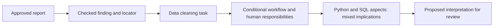

# First deliverable: updateable evidence to task and skill implications

This is a working Data Analyst example with a real live-fetch receipt, offline
JSON response, validated references and a proposed interpretation for team
review. It does not assign new numerical weights or predict job survival.

## Read the example

| Link in the chain | What this example contains |
|---|---|
| Source | [Anthropic's January 2026 Economic Index report](https://www.anthropic.com/research/anthropic-economic-index-january-2026-report), published 2026-01-15 |
| Study period | 2025-11-13 through 2025-11-20; publication and retrieval dates remain separate |
| Finding | Estimated success is lower for tasks requiring more human time. Claude assesses success; this is not an independent correctness audit. |
| Finding locator | Introduction; Chapter 2's measure definition and validation; Chapter 4, task horizons and Figure 4.3; Chapter 1 footnote 1 for sample dates |
| Existing role/task | `role:data_analyst` / `task:data_cleaning` |
| Proposed interpretation | If AI drafts routine cleaning code, manual drafting effort may shift toward specifying transformations and validating results. The report motivates the reliability concern; it does not establish adoption of this workflow. |
| Assumptions | Appropriate data may be processed with AI; routine code can be drafted; an analyst remains responsible and can inspect/test transformations. |
| Human responsibilities | Define missing-value and duplicate rules; inspect transformations and joins; check key uniqueness, row counts and data loss. |
| Python implication | **Mixed:** potentially less repetitive manual drafting, with more learning emphasis on reading, debugging and testing generated code under these assumptions. |
| SQL implication | **Mixed:** potentially less repetitive query drafting, with more emphasis on checking joins, null handling and results under these assumptions. |
| Employer demand | **Insufficient evidence** for an increase or decrease in Python/SQL hiring demand. |
| Status and horizon | `proposed_for_review`; conditional workflow, with no dated forecast. |

The real finding is evidence. The workflow, human responsibilities and skill
implications are project-authored reasoning. Neither the platform sample nor
our synthetic role catalog establishes Malaysian employer requirements.
The reported pattern is not causal evidence that AI adoption increases the
importance of any particular skill.



## Run and inspect

From the repository root:

```bash
python -m src.intelligence.feeds --review data/sources/anthropic_task_complexity_2026.json
python -m src.intelligence.impacts
python -m unittest discover -s tests -v
```

The first command needs internet access and returns a `snapshot_path`. The other
commands run offline. To regenerate the demo artifacts after a successful
refresh, substitute that actual snapshot path below:

```bash
python -m scripts.build_role3_demo --snapshot data/snapshots/trends/YOUR_SNAPSHOT.json
```

The builder requires that the snapshot describes the current validated ledger.
Use real fetch output for committed evidence; test HTTP fixtures are confined
to temporary directories.

- Review definition: `data/sources/anthropic_task_complexity_2026.json`.
- Approved release registry: `data/sources/approved_sources.json`.
- Current evidence and reasoning: `data/processed/trend_signals.json`.
- Before/after example and actual snapshot reference:
  `data/demo/data_analyst_evidence_chain.json`.
- Fetch receipts and structured evidence snapshots: `data/snapshots/trends/`.

## What updateable means here

**Rechecking the same release:** rerun the refresh command. It fetches the real
page, validates the reviewed heading/date/claim markers, records response and
review hashes, updates the retrieval date and saves a structured snapshot.
It does not relabel the publication date as today. An unchanged same-day ledger
returns `unchanged`; a later retrieval date is a metadata update, not new research.

**Adding a reviewed new release:** add its exact HTTPS URL, unique source ID,
publisher and publication date to `approved_sources.json`. Create a new source
review JSON with the publication/claim markers, paraphrased finding, task mapping
and optional evidence chains. Use unique signal/chain IDs for a different
release. Refresh it with `--review PATH`. No fetcher code change is needed.
The allowlist is trusted local configuration, not an arbitrary URL input exposed
to website users. Redirects remain rejected.

**Revising an interpretation:** edit its source review definition. Each chain
is bound to the exact reviewed signal and source metadata with a SHA-256
fingerprint, excluding the retrieval date. After checking the source and
revising affected reasoning, compute the new fingerprint with
`src.schemas.trends.evidence_fingerprint(source, signal)`. Validation alone is
not evidence that the revised interpretation is sound. Changing a reviewed
finding without revising its binding is rejected before fetching.

**Withdrawing an interpretation:** remove its chain from the owning signal's
review and successfully refresh that review. The chain disappears from subsequent
responses. Old snapshots remain as history. A chain ID cannot be reassigned to
another signal during a merge.

**Failure:** missing checked markers, unapproved sources, invalid references or
network failures preserve the prior validated ledger. Display the refresh
warning returned by `get_refresh_status()` beside cached evidence.

This supports explicit refresh of reviewed sources. It does not discover new
publications, interpret arbitrary page changes, retrain a model, or schedule a
5 AM job. Marker checks cannot detect every semantic revision; they verify
selected reviewed content. Different publications remain separate historical
records, without an automatic resolution of conflicting findings. A successful
fetch does not establish that this is the latest research. Person 5 can schedule
reviewed refresh commands later; changed/new findings still need review.

An additional [candidate extraction stage](ROLE_3_EXTRACTION.md) can now generate
proposed findings from an approved URL using Gemini. That stage does not require
a prewritten finding, but it saves candidates separately for review; it does not
change how accepted evidence is refreshed here.

## Integration contract

```python
from src.intelligence.impacts import get_evidence_chain_response
from src.intelligence.feeds import get_refresh_status

response = get_evidence_chain_response("role:data_analyst")
refresh_status = get_refresh_status()
```

Each response joins reasoning to its finding, source citation, task label and
skill labels. Render publication/retrieval/study dates, the source link,
assumptions, limitations, `proposed_for_review`, `catalog_synthetic`, and the
refresh warning. The response's `ledger_sha256` hashes canonical validated ledger
JSON for comparison; it is distinct from the fetched HTTP body's hash.

Unknown role raises `KeyError`. Roles without a chain return
`status=insufficient_evidence` and an empty `chains` list. Invalid evidence fails
validation rather than silently producing an implication.

Evidence ledger schema **0.2.0** adds `evidence_chains`; the loader still accepts
old 0.1.0 ledgers without chains. The existing `RoleOutlook` and `ScenarioResult`
contracts stay unchanged. Person 5 can consume this separate service alongside
the outlook. Person 4 must not turn these proposed qualitative implications
into numerical adjustments automatically. The existing scenario numbers remain
authored demo assumptions, separate from this evidence chain.

## Verification

Tests cover live-artifact consistency, source-to-task-to-skill references,
next-day refresh, updated findings, stale bindings, withdrawal, isolation of
other roles, unchanged scenario priorities, registry extension, invalid sources,
and preservation of cached reasoning when validation fails. The live receipt
records transport/marker verification; it is not an independent audit of the study.
