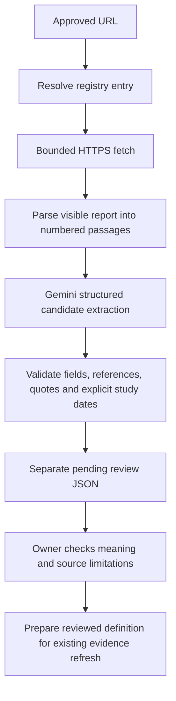

# Automatic candidate finding extraction

Given an exact approved report URL, the new command retrieves readable HTML,
asks Gemini to propose up to three findings, checks supporting text references
and saves a separate `pending_review` record. You do not need to write the
findings or a source review JSON before running this stage.

The feature implements finding extraction only. Task/skill interpretations and
acceptance into the evidence ledger remain separate reviewed steps.

## Run

The code uses Python's standard library plus the existing Pydantic dependency;
no new runtime package is required. The report must be in
`data/sources/approved_sources.json`. The existing Anthropic report is ready.

Set `GEMINI_API_KEY` through your process environment or Replit Secrets. On
PowerShell, this prompts without showing the key or placing it in command history:

```powershell
$extractionKey = Read-Host "Gemini API key" -AsSecureString
$env:GEMINI_API_KEY = [System.Net.NetworkCredential]::new('', $extractionKey).Password
Remove-Variable extractionKey
python -m src.intelligence.extraction --url https://www.anthropic.com/research/anthropic-economic-index-january-2026-report
```

The CLI reads environment variables; it does not automatically load `.env`.
`GEMINI_MODEL` or `--model` overrides the default `gemini-3.5-flash-lite`.
Actual availability and quotas depend on the Google project. The implementation
does not enable billing or silently switch models. It makes one generation
request per run, with no automatic retries.

For a fetch/parser check without credentials, a model call or saved article:

```bash
python -m src.intelligence.extraction --url https://www.anthropic.com/research/anthropic-economic-index-january-2026-report --inspect-source
```

Successful extraction returns the candidate path, count, model and
`accepted_evidence_changed=false`. Candidates are saved under
`data/review/candidates/`. An explicit no-findings response is saved too, with its
reason. Failures exit with code 1 and leave previous candidates and accepted
evidence untouched; errors do not include API keys or raw provider bodies.

## Processing and validation



- Source metadata comes from the trusted registry. A visible publication-date
  check is required. The registry must be maintained by an owner, not by the model.
- The fetcher uses exact allowlisted URLs, rejects redirects, caps HTML at 2 MiB
  and uses the existing socket/read timeout bounds.
- The parser removes script/style/navigation/footer and directly hidden content,
  prefers `main`/`article` text, and retains numbered passages and section headings.
  It does not run JavaScript or evaluate external CSS.
- Readable input is capped at 120,000 characters. Oversized/empty reports fail;
  the program does not silently truncate the report or claim exhaustive coverage.
- The provider receives report text as untrusted data with explicit instructions
  to extract findings only. It has no tools, credentials in its prompt, or access
  to the accepted-evidence writer. Prompt instructions reduce risk but cannot
  guarantee resistance to every misleading source instruction.
- Pydantic rejects unknown fields, malformed types, incomplete date intervals,
  and attempts to return approval or skill-adjustment fields.
- Each supporting quote must be an exact contiguous snippet in the referenced
  normalized passage. Its section, paragraph hash and character offsets are saved.
  There are at most three quotes, with at most eight words each; no full article
  or complete paragraph is stored.
- Study periods remain unknown unless both complete endpoints are present in
  the cited passage. Abbreviated date ranges are not inferred, and study dates
  cannot follow publication. The model can still overlook an available date;
  the owner should check methodology and footnotes during review.
- Claims and limitations have explicit word/size limits. Duplicate identical
  findings are collapsed. Each run gets a fresh filename, preserving history;
  content-derived candidate IDs stay stable for identical parsed input/findings.

These checks establish traceability and structure. They do not verify the study's
truth, causal claims or whether every sentence of a paraphrase follows from its
citation. All outputs retain `pending_review`, including technically valid ones.

## Code responsibilities

| Module | Responsibility |
|---|---|
| `src/schemas/sources.py`, `src/intelligence/sources.py` | Source contracts and registry resolution |
| `src/intelligence/reports.py` | Pure HTML parsing, passage references and content hashes |
| `src/schemas/extraction.py` | Candidate and stored-record contracts |
| `src/intelligence/extractors.py` | Provider-independent extractor interface and result |
| `src/intelligence/gemini.py` | Gemini HTTP request, structured output and sanitized errors |
| `src/intelligence/extraction.py` | Validation, orchestration and CLI |
| `src/intelligence/storage.py` | Shared atomic JSON writes |

The existing feed module re-exports its source models and JSON helper for
compatibility. Existing outlook and scenario contracts are unchanged.
Network and model dependencies can be replaced in tests without touching real
sources or credentials.

## Updateable sources and review

For a new report, an owner adds its exact URL, unique source ID, publisher and
publication date to the registry, then runs the extraction command with that URL.
No model retraining or prewritten finding is needed. Re-running fetches the
current page and saves a new candidate record with fetched-body and parsed-text
hashes. A new fetch date is not a new publication date.

After reviewing a candidate, prepare the accepted source definition used by
`python -m src.intelligence.feeds --review PATH`. The extraction record cannot be
passed directly to that command. No automatic discovery, approval, job forecast,
task/skill generation or scheduler is included in this extraction stage.

The separate [approval CLI](ROLE_3_APPROVAL.md) now prepares and explicitly
approves that definition without hand-editing JSON. It can carry reviewed
wording, limitation and classification corrections, plus an optional task
interpretation. Extraction itself still cannot approve or promote findings.

## Test evidence

```bash
python -m unittest discover -s tests -v
```

Offline tests use explicitly fictional HTML and a stub extractor. They cover
hidden content, dates, size limits, stable references, fabricated quotes, schema
violations, unknown dates, history preservation, source restrictions, candidate
isolation, API errors and credential handling. Normal tests never call Google.

The real Gemini run on 2026-10-20 parsed 184 passages and generated three pending
findings. See `data/review/README.md` for the actual record and review notes,
including a generated limitation that needs correction. This is a live integration
check, not a measured extraction-accuracy evaluation.

Gemini implementation references: [structured outputs](https://ai.google.dev/gemini-api/docs/generate-content/structured-output),
[REST API](https://ai.google.dev/api/generate-content), and
[model documentation](https://ai.google.dev/gemini-api/docs/models/gemini-3.5-flash-lite).
